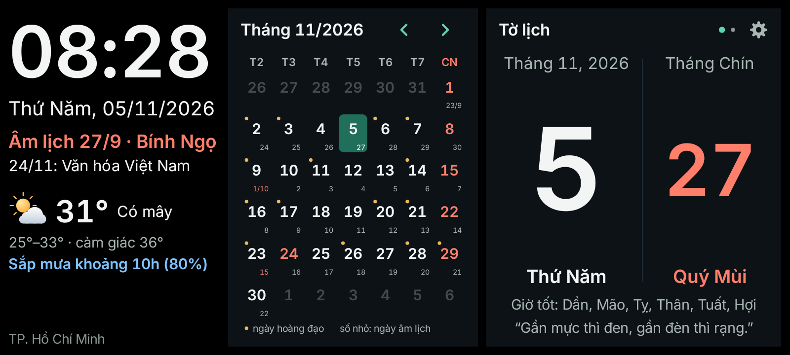
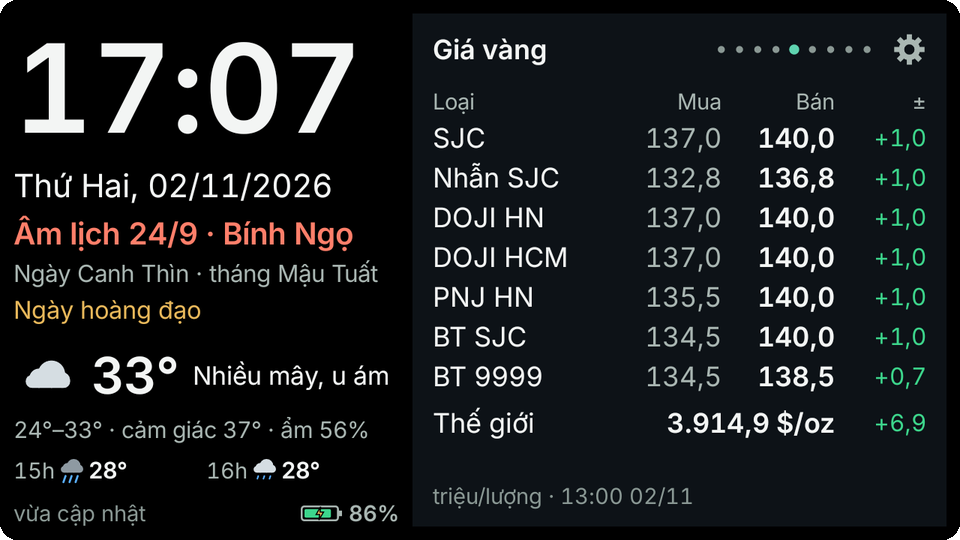
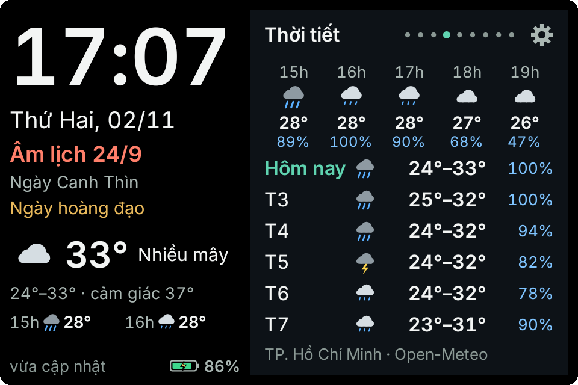
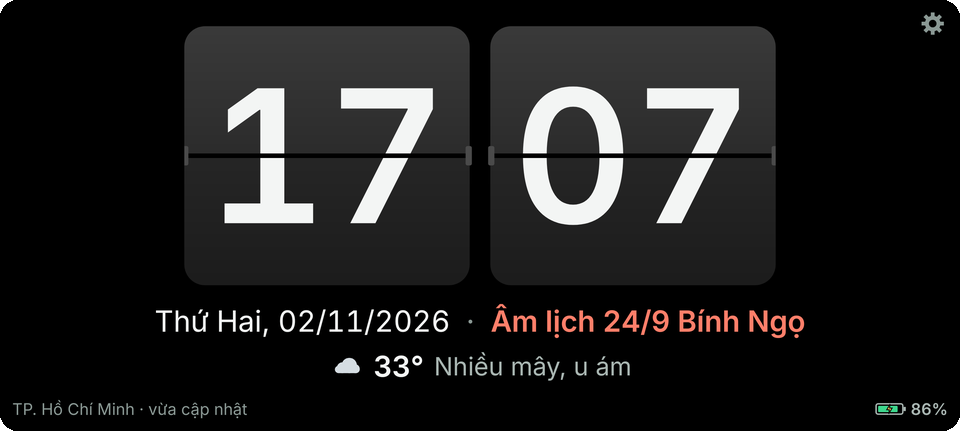
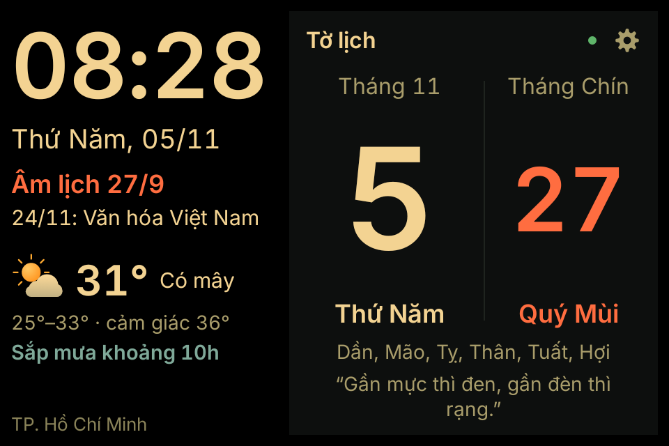

<p align="center">
  
</p>

<p align="center">
  <a href="https://github.com/traique/nhat-nguyet/releases/latest"></a>
  
  <a href="https://github.com/traique/nhat-nguyet/actions/workflows/android.yml"></a>
</p>

**Nhật Nguyệt** biến một chiếc điện thoại Android, kể cả máy rất cũ, thành tấm lịch treo tường: đồng hồ cỡ lớn, lịch âm dương, thời tiết, giá vàng, xăng dầu, tỷ giá, chứng khoán và tin tức trên một màn hình nằm ngang.

Không cần tài khoản, không quảng cáo, không qua máy chủ trung gian: ứng dụng lấy dữ liệu thẳng từ các nguồn công khai.

<p align="center">
  
</p>

<table>
  <tr>
    <td width="50%"></td>
    <td width="50%"></td>
  </tr>
  <tr>
    <td align="center"><sub>5,5" · trang giá vàng</sub></td>
    <td align="center"><sub>3,5" · trang dự báo thời tiết</sub></td>
  </tr>
  <tr>
    <td></td>
    <td></td>
  </tr>
  <tr>
    <td align="center"><sub>Đồng hồ lật</sub></td>
    <td align="center"><sub>Ban đêm, chữ tông ấm</sub></td>
  </tr>
</table>

## Tính năng

- **Bảng lịch tự co giãn.** Cột trái luôn hiện giờ, thứ ngày, âm lịch, can chi, ngày lễ, thời tiết hiện tại và pin. Mỗi dữ kiện nằm gọn một dòng; màn nhỏ tự ẩn dòng kém quan trọng thay vì thu chữ.
- **Tờ lịch.** Ngày dương thật lớn, ngày âm màu đỏ son, can chi, giờ hoàng đạo và một câu ca dao mỗi ngày, như tờ lịch bloc treo tường.
- **Lịch âm dương chính xác.** Thuật toán Hồ Ngọc Đức theo múi giờ +7: tháng nhuận, can chi ngày tháng năm, tiết khí, ngày và giờ hoàng đạo, ngày lễ, đếm ngược Tết.
- **Thông tin cập nhật.** Thời tiết theo giờ và 6 ngày, giá vàng, giá xăng dầu, tỷ giá Vietcombank, chứng khoán trong phiên, tin tức RSS. Các trang tự xoay vòng; chạm để sang trang, vuốt ngang để tiến hoặc lùi.
- **Đồng hồ lật.** Chế độ chỉ đồng hồ với hai thẻ giờ phút cỡ lớn, kèm ngày, âm lịch và thời tiết nếu muốn.
- **Vuốt để chỉnh độ sáng.** Vuốt lên hoặc xuống trên đồng hồ để tăng giảm độ sáng ngay; mức mới được lưu cho ban ngày hoặc ban đêm tuỳ lúc chỉnh.
- **Thời tiết theo vị trí.** Gõ tên thành phố hoặc bấm *Dùng vị trí hiện tại* để lấy toạ độ từ GPS/Wi‑Fi của máy. Kèm chất lượng không khí (AQI, bụi mịn PM2.5, tô màu theo mức) và dòng nhắc "Sắp mưa khoảng 15h" từ dự báo theo giờ.
- **Ngày giỗ, sinh nhật.** Tự thêm ngày riêng theo âm hoặc dương lịch (vd. `15/8 âm Giỗ ông nội`). Bảng lịch nhắc trước 7 ngày, tờ lịch ghi tên ngày, lịch tháng đánh dấu chấm đỏ; ngày 30 âm rơi vào tháng thiếu thì tính là ngày 29.
- **Khoá Cài đặt.** Đặt mã PIN để người khác không đổi được cài đặt khi máy treo ở nơi chung.
- **Ngày và đêm.** Giờ ngày màn hình luôn sáng. Ban đêm chọn giảm sáng, tắt theo thời gian chờ hoặc tắt hẳn; chữ chuyển tông ấm để bớt ánh sáng xanh. Vẫy tay qua cảm biến tiệm cận để bật màn, che cảm biến khi màn đang sáng để tắt; tự bật lúc sáng, chống lưu ảnh.
- **Chạy được ngoại tuyến.** Dữ liệu được lưu lại; mất mạng vẫn hiện số liệu gần nhất kèm nhãn "dữ liệu cũ".
- **Canh giờ máy.** So với giờ của các máy chủ dữ liệu; giờ máy lệch từ 2 phút (hay bị về năm cũ khi hết pin) thì dòng trạng thái báo, chạm để mở cài đặt ngày giờ.
- **Tự cập nhật.** Tải bản mới từ GitHub Releases, kiểm tra SHA-256 và tên gói trước khi cài.
- **Hợp máy cũ.** Android 4.0.3 trở lên, không cần root. Tự nhúng TLS 1.2 và bộ chứng chỉ gốc nên máy đời cũ vẫn kết nối được các trang HTTPS hiện nay.

## Cài đặt

1. Tải tệp `NhatNguyet-x.y.z.apk` mới nhất ở trang [Releases](https://github.com/traique/nhat-nguyet/releases/latest).
2. Mở tệp để cài. Lần đầu máy sẽ hỏi quyền cài ứng dụng từ nguồn ngoài:
   - Android 4.x đến 7.x: *Cài đặt > Bảo mật > Nguồn không xác định*.
   - Android 8 trở lên: cho phép trình duyệt hoặc trình quản lý tệp *cài ứng dụng không rõ nguồn*.
3. Mở **Nhật Nguyệt**, đặt máy nằm ngang và cắm sạc. Bấm biểu tượng bánh răng ở góc trên bên phải để vào **Cài đặt** (hoặc giữ lâu vào đồng hồ). Vuốt dọc trên đồng hồ để chỉnh độ sáng.

Gợi ý khi dùng làm lịch treo tường:

- Đặt khoá màn hình là *Không* hoặc *Vuốt* để bảng tự hiện lại sau khi màn hình bật.
- Nếu chọn "Tắt theo thời gian chờ" ban đêm, đặt thời gian chờ màn hình của máy khoảng 15–30 giây.
- Samsung, Xiaomi, Oppo: cho Nhật Nguyệt chạy nền và tự khởi động trong phần quản lý pin của máy.

## Tự động cập nhật

Ứng dụng định kỳ đọc `update.json` của bản phát hành mới nhất, tải APK ngầm, kiểm tra SHA-256 và tên gói rồi mới mời cài:

| Android | Cách cài bản mới |
|---|---|
| 4.x – 6.x | Mở trình cài đặt của máy, bấm **Cài đặt** một lần (máy không root không cài im lặng được). |
| 7 trở lên | Cài qua PackageInstaller. Android 8+ cần cho phép Nhật Nguyệt cài ứng dụng; Android 12+ có thể không cần bấm từ lần cập nhật thứ hai. |

Trong Cài đặt có thể chọn giờ tự mở màn hình cài trong ngày. Khi có bản mới, dòng trạng thái hiện "Có bản mới … chạm để cài". Cài xong ứng dụng tự mở lại.

## Màn hình hỗ trợ

| Kích thước | Bố cục |
|---|---|
| 3,5" – 4" | 2 cột; các dòng phụ tự ẩn khi thiếu chỗ, chữ không nhỏ hơn mức đọc được |
| 4,5" – 5,5" | 2 cột, hiện đủ can chi và dự báo theo giờ |
| 6,1" – 6,7" (tỉ lệ khoảng 20:9) | 3 cột: giờ và âm lịch · lịch tháng · trang xoay vòng |

Có thể ép 2 cột hoặc 3 cột và chỉnh cỡ chữ trong Cài đặt.

## Nguồn dữ liệu

| Trang | Nguồn | Làm mới |
|---|---|---|
| Tờ lịch, lịch tháng, âm lịch | Tính ngay trên máy | – |
| Thời tiết, chất lượng không khí | [Open-Meteo](https://open-meteo.com) | 15 phút |
| Tên nơi theo vị trí hiện tại | [OpenStreetMap Nominatim](https://nominatim.org) | khi bấm *Dùng vị trí hiện tại* |
| Giá vàng (SJC, nhẫn, DOJI, PNJ, Bảo Tín, thế giới) | vang.today | 10 phút |
| Giá xăng dầu Petrolimex | giaxanghomnay.com | 1 giờ |
| Tỷ giá | Vietcombank | 30 phút |
| Chứng khoán (chỉ số và mã tự chọn) | Entrade / DNSE | 1 phút trong phiên, 30 phút ngoài phiên |
| Tin tức | RSS tự chọn | 10 phút |

Ứng dụng chỉ tải dữ liệu khi màn hình đang sáng. Lỗi ở một nguồn chỉ ảnh hưởng trang đó và được báo trên dòng trạng thái.

## Quyền ứng dụng

| Quyền | Dùng để |
|---|---|
| Internet, trạng thái mạng | Tải dữ liệu từ các nguồn ở trên |
| Vị trí (tuỳ chọn) | Chỉ khi bấm *Dùng vị trí hiện tại*, để lấy thời tiết đúng nơi |
| Giữ màn hình sáng, bật màn hình, báo thức chính xác | Giờ ngày luôn sáng, tự bật màn lúc bắt đầu giờ ngày |
| Khởi động cùng máy | Tự mở bảng lịch sau khi bật máy |
| Dịch vụ nền và thông báo | Giữ cảm biến tiệm cận để vẫy tay bật màn |
| Hiện trên ứng dụng khác, bỏ tối ưu pin | Để bảng lịch tự hiện lại trên Android đời mới |
| Cài gói ứng dụng | Cập nhật bản mới |
| Quản trị thiết bị (tuỳ chọn) | Tắt hẳn màn hình ban đêm hoặc khi che cảm biến; gỡ quyền này trong Cài đặt trước khi gỡ ứng dụng |

## Dành cho nhà phát triển

### Build trên máy

```bash
./gradlew :app:testDebugUnitTest :app:lintDebug :app:assembleDebug
```

Cần JDK 17 trở lên và Android SDK (platform 34). Giao diện dựng bằng View thường, không dùng AndroidX hay Compose; lint chạy với `NewApi` là lỗi nên build sẽ hỏng nếu lỡ gọi API mới hơn Android 4.0.3 mà không kiểm tra phiên bản.

Bản debug có tên gói `vn.nhatnguyet.debug`, cài song song với bản chính thức và không tự cập nhật. Muốn thử cập nhật với máy chủ khác (vd. máy ảo gọi `http://10.0.2.2:8000/update.json`), đặt biến `UPDATE_URL` khi build.

### Phát hành bản mới

Workflow `.github/workflows/android.yml` chạy kiểm thử và lint, build bản release đã ký, rồi tạo GitHub Release chứa `NhatNguyet-X.Y.Z.apk` và `update.json`.

1. Tạo khoá ký một lần và **giữ thật kỹ** (mất khoá là không cập nhật được nữa; dùng RSA để Android 4.x đọc được chữ ký):
   ```bash
   keytool -genkeypair -v -keystore nhatnguyet.jks -alias nhatnguyet -keyalg RSA -keysize 2048 -sigalg SHA256withRSA -validity 36500
   base64 -w0 nhatnguyet.jks > nhatnguyet.jks.b64
   ```
2. Trong repo: *Settings > Secrets and variables > Actions*, thêm 4 secret: `KEYSTORE_BASE64` (nội dung tệp `.b64`), `KEYSTORE_PASSWORD`, `KEY_ALIAS`, `KEY_PASSWORD`.
3. Mở *Actions > Android > Run workflow*, nhập số phiên bản (vd. `1.0.1`) rồi chạy. Workflow tự tạo tag `v1.0.1` và Release. Cách khác: `git tag v1.0.1 && git push origin v1.0.1`.

`versionCode = X×10000 + Y×100 + Z`, nên mỗi bản sau phải có số phiên bản lớn hơn. Workflow từ chối phát hành nếu APK bị ký bằng khoá debug.

### Cấu trúc mã

```
app/src/main/java/vn/nhatnguyet/
  App, Prefs, Fmt, Theme   cài đặt, định dạng số kiểu Việt Nam, bảng màu ngày/đêm
  net/      Tls (Conscrypt + kho chứng chỉ gốc), Http
  lunar/    Lunar (âm lịch, can chi, tiết khí, hoàng đạo, ngày lễ), LunarDate
  data/     DataHub (lịch tải, bộ nhớ đệm), các nguồn Weather, Gold, Fuel, Fx, Stock, News
  ui/       MainActivity (bảng lịch), Pages, SettingsActivity, các view tự vẽ
  sys/      WakeService (cảm biến tiệm cận), BootReceiver, Scheduler, AdminReceiver
  update/   Updater, SessionInstall, InstallReceiver
```

## Đã kiểm thử

- Kiểm thử đơn vị: âm lịch (Tết 2020–2027 và 1985, tháng nhuận 2023 và 2025, Trung thu 2026, đổi qua lại 1990–2060), bộ đọc giá vàng, xăng dầu, tỷ giá, thời tiết và RSS trên dữ liệu thật.
- Máy ảo Android 4.1.2 (API 16): cài APK ký v1, TLS qua Conscrypt, tải đủ các nguồn dữ liệu, font tiếng Việt, xoay trang, vẫy tay bật màn và trọn quy trình tự cập nhật.
- Bố cục dựng thử ở 480×320 dp (3,5"), 640×360 dp (5,5") và 915×411 dp (6,7").
- Chưa thử trên máy thật Android 4.0.3 và máy 6,7" thật.

## Lưu ý

- vang.today, giaxanghomnay.com và Entrade/DNSE là nguồn không chính thức, có thể thay đổi bất cứ lúc nào.
- Nhiều máy đời mới chỉ bật cảm biến tiệm cận khi đang gọi, nên vẫy tay có thể không đánh thức được màn hình đã tắt.
- Điện thoại cũ cắm sạc liên tục dễ phồng pin: giữ độ sáng đêm thấp và thỉnh thoảng kiểm tra máy. Dòng trạng thái cảnh báo khi pin nóng từ 45°C.

## Thành phần bên thứ ba

- Font [Inter](https://rsms.me/inter/) (bản rút gọn): SIL Open Font License 1.1, xem `app/src/main/assets/fonts/OFL.txt`.
- [Conscrypt](https://github.com/google/conscrypt): Apache License 2.0.
- Bộ chứng chỉ gốc `res/raw/cacerts.pem`: từ kho chứng chỉ của Mozilla (MPL 2.0).
- Dữ liệu thời tiết: [Open-Meteo](https://open-meteo.com) (CC BY 4.0).
- Tên nơi theo toạ độ: dữ liệu © [OpenStreetMap](https://www.openstreetmap.org/copyright) contributors (ODbL).

<p align="center"><sub>design by LCTA</sub></p>
